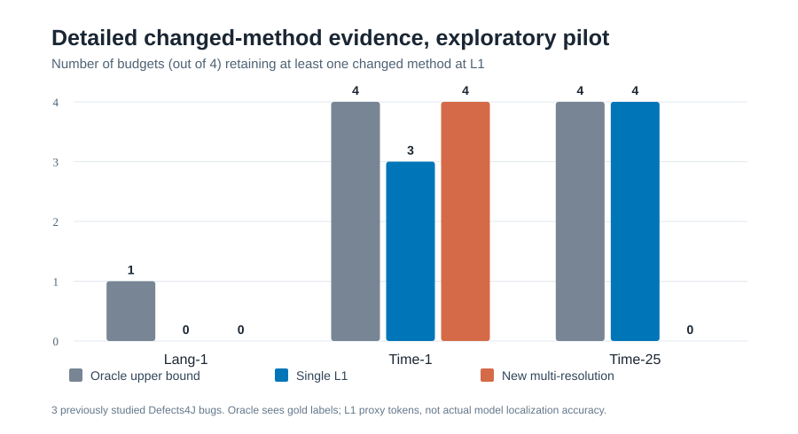

# AITECH research: read this before interpreting results

**Objective:** improve AI software fault localization by selecting only useful
failure-related code and dependency evidence under strict context budgets.

**Status, 2026-11-11:** engineering experiments and several reproducible
negative results, **not yet a validated new localization method**.

## Study map

| Question | Primary script | Report or artifact | Scientific status |
|---|---|---|---|
| When does full dependency closure discard failure anchors? | `aitech/real_bug_closure_stress.py` | `reports/AITECH_AGENT_LIVE_CPU_PILOT_20261111.md` | 2 bugs, CPU evidence proxy |
| Does name+arity call parsing improve dependency quality? | `aitech/java_call_audit.py` | `reports/AITECH_ARITY_CALL_AUDIT_20261111.md` | syntactic candidates, not verified targets |
| Can javac disambiguate overloaded caller and callee identities? | `aitech/compiler_attribution_acceptance.py` | `reports/AITECH_CALLER_SIGNATURE_MAPPING_20261111.md` | controlled compiler fixture |
| Does risk-gated expansion select useful extra evidence? | `aitech/risk_gated_pilot.py` | `reports/AITECH_RISK_GATED_NEGATIVE_RESULT_20261111.md` | no graph-driven gain |
| Does historical source retrieval help a failed Java test? | `aitech/time1_verified_retrieval_study.py` | `reports/AITECH_ACTIVE_RETRIEVAL_NEGATIVE_RESULT_20261111.md` | no extra changed-method recall |
| Which L0/L1 hierarchy preserves patched code? | `aitech/tiered_evidence_pilot.py` | `reports/AITECH_PACES_FL_NOVELTY_HYPOTHESIS_20261111.md` | identity gains, not model gains |
| Does new marginal-utility selection outperform strong tiered controls? | `aitech/compare_strong_tiered_baselines.py` | `reports/AITECH_VERIFIED_RESEARCH_DECISION_LEDGER_20261111.md` | **rejected: 0 wins, 4 losses** |
| What L1 source could have been retained with gold knowledge? | `aitech/changed_method_oracle_ceiling.py` | decision ledger and SVG figure | posthoc gold-aware oracle, not inference |
| Can any one of several sufficient support paths prevent dangling evidence? | `aitech/alternative_support_ablation.py` | `reports/AITECH_ALTERNATIVE_SUPPORT_PATHS_20261111.md` | controlled synthetic exact small-case result, not real localization |
| Can javac calls suggest support without claiming causality? | `aitech/compiler_support_proposals.py` | provenance-gated source-backed candidate proposals | implemented, unverified sufficiency; no LLM |
| Does a small code LLM actually localize more bugs? | `aitech/cpu_llm_localization.py` | one-shot Actions `aitech-cpu-llm-paired-v2.yml` | configured, result NOT verified |

## Research direction: learned marginal benefit/harm of debugging evidence (2026-11-11)

The newest AITECH candidate mechanism is a *provenance-gated, cost-aware
retrieve/upgrade/STOP controller*. Code is implemented, but there is
**no demonstrated independent LLM localization improvement yet**.

- Core action selector: `aitech/marginal_action_policy.py`
- Project-disjoint paired LLM outcome contract:
  `aitech/paired_action_outcomes.py`
- Three-outcome outcome-learning and independent calibration:
  `aitech/train_marginal_outcomes.py`
- Real Qwen STOP vs L0-to-L1 development experiment:
  `aitech/cpu_action_counterfactual.py`
- Held-out STOP / cheapest / learned / posthoc-oracle ablation:
  `aitech/evaluate_marginal_policy.py`
- One-shot CPU workflow:
  `.github/workflows/aitech-cpu-action-counterfactual.yml`
- Full novelty and acceptance report:
  `reports/AITECH_MARGINAL_ACTION_NOVELTY_PROTOCOL_20261111.md`

The model will abstain unless it has an independently calibrated
outcome estimator, and GRAPH actions require compiler-verified calls.
The classifier-training input requires **actual paired model predictions**
from independent training, calibration and test projects. Old Lang/Time
snapshots remain development-only and cannot count as unseen tests.

## Failure-grounded retrieval and related-API ablation (November 11, 2026)

This research iteration measures two different things separately:

- **Candidate class recall:** `aitech/related_api_retrieval.py` restores
  source-present reciprocal API siblings such as
  `CpioArchiveInputStream` -> `CpioArchiveOutputStream`.
  On the previously studied Compress-1 case, changed-class
  presence in eight candidates improved **0/1 -> 1/1**.
- **Downstream LLM localization:** `aitech/related_api_cpu_localization.py`
  compares the same Qwen1.5B model with stack-only retrieval,
  related-API retrieval, causal explanation, reverse order, and
  a behavior-bearing peer L1 source upgrade.
  **None of the related-API or added-source conditions improved
  Compress-1 class Hit@1.** On Codec-1 reversed ordering alone
  changed the chosen class, demonstrating position sensitivity.

- Full verified audit:
  `reports/AITECH_RETRIEVAL_REDESIGN_AND_RELATED_API_RESULTS_20261111.md`
- One-shot source-candidate recall workflow:
  `.github/workflows/aitech-related-api-recall.yml`
- Same-model LLM workflow:
  `.github/workflows/aitech-related-api-llm.yml`

These are development bugs, not untouched project-level evaluations.
We must not claim superiority or a trained marginal-harm controller.

## Figures



Bar heights represent the number of tested proxy-token budgets (out of four)
that retained at least one gold changed-method L1 sketch. Not LLM accuracy.

## Local CPU reproduction

No GPU, AIScalar, paid model API, or Defects4J checkout is needed for the
archived-source selector experiments.

```bash
git switch AITECH
python -m unittest discover -s tests -p 'test_aitech_*.py' -v
python -m aitech.failure_conditioned_study \
  --output results/aitech/failure_conditioned_three_bug.json
python -m aitech.multiresolution_study \
  --output results/aitech/multiresolution_three_bug.json

# Posthoc evaluation only AFTER selection output is frozen:
python -m aitech.score_multiresolution_posthoc \
  --frozen results/aitech/multiresolution_three_bug.json \
  --output results/aitech/multiresolution_posthoc.json
python -m aitech.changed_method_oracle_ceiling \
  --frozen results/aitech/multiresolution_three_bug.json \
  --output results/aitech/changed_method_oracle.json
```

## Publishability gate

Never report retained failure-name anchors or L0 method IDs as fault
localization accuracy. The next credible result must be a paired run of the
**same actual LLM** with frozen evidence, matched model-token budget, saved
raw predictions, and posthoc scoring on independent bugs.

Related work includes ARISE (2026), FaR-Loc (2025), BLAgent (2026),
Retrieval-Oriented Code Representations (2026), and CosFL (2026).
Read `reports/AITECH_NOVELTY_HYPOTHESIS_AND_PROTOCOL_20261111.md`
before claiming a unique contribution.

## Scheduling

No research cron schedule. The prior ChatGPT daily automation was disabled
at the user's request. GitHub CI runs on push or manual invocation only.
