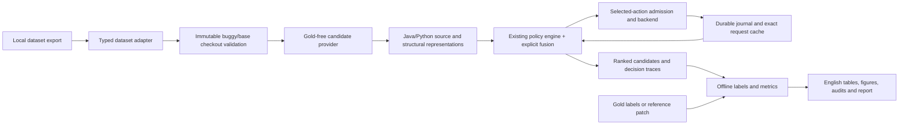

# RAVE-FL Universal Multi-Dataset Evaluation

This layer runs **localization**, not patch generation or official SWE-bench issue resolution. It wraps the existing RAVE-FL controllers. Historical V1/V2/V3 artifacts remain separate and unchanged. Infrastructure validation uses synthetic providers and saved observations only; no new live model experiment or A100 performance measurement was performed during development.

## Quick start without inference

Run from the repository root with Python 3.10 or newer. Development validation used Python 3.11 on macOS. Install dependencies explicitly in your chosen environment if needed; setup scripts do not install software:

```bash
python3 -m pip install -r requirements-rave-eval.txt
bash scripts/rave_fl_run.sh list-datasets
bash scripts/rave_fl_setup_mac.sh --dataset defects4j --model llama3.1:8b
python3 -m rave_fl.eval.fixtures --output-dir /tmp/rave-fixture
bash scripts/rave_fl_run.sh run \
  --dataset custom --dataset-file /tmp/rave-fixture/instances.json \
  --backend fake --model fake:fixture --context-window 4096 \
  --candidate-count 10 --policies full,fixed_l1,highest_suspicion,v2_utility,uncertainty_aware \
  --output-dir /tmp/rave-fixture-run --run-id synthetic-demo
bash scripts/rave_fl_run.sh report --run-dir /tmp/rave-fixture-run
```

Choose unused output paths. `fake` produces deterministic synthetic observations, separately marked throughout the results. Synthetic scores and timings are not benchmark findings. The fixture creator initializes and commits a tiny new repository; it never downloads or tests a benchmark checkout.

The executable entry point is [scripts/rave_fl_run.sh](../scripts/rave_fl_run.sh). It exports this repository on `PYTHONPATH`, handles spaces, and respects `RAVE_PYTHON`. It does not change the calling directory. Use absolute manifest/checkouts paths when invoking it elsewhere.

## Architecture and implementation boundaries



`rave_fl/eval/schema.py` defines immutable `OnlineInstance`, `Evidence` and `CodeEntity`. `GoldLabels` is a separate offline type. Adapters discard patches, test patches, post-fix logs, PR hints and localization labels from online objects. The candidate provider and model see issue text and explicitly permitted evidence, never gold labels. Offline labels are loaded after observation collection. Gold hashes are recorded in evaluation results, separately from online fingerprints.

`runner.py` separates checkout validation/preparation, candidate generation, representation, policy execution, and evaluation. `backend.py` implements the provider, accounting journal and cache. `metrics.py` handles offline references and multiple locations. `reporting.py` regenerates tables and figures from saved results. No learned controller, risk model, calibration fit or heuristic optimization was added.

Three existing modules expose optional fusion callbacks: `adaptive.py`, `rank_repair.py`, `selection_controls.py`. Their default scoring, order, prompts and old entry points retain their historical behavior. The new wrapper preserves exact Java method prompts; Python prompts identify Python, and file inspection explicitly identifies the file as the entity. See the preserved [V3 research report](../reports/RAVE_FL_Research_Progress_Report.md) and [V3 reproducibility report](../reports/RAVE_FL_Reproducibility.md) for earlier experiments.

## Datasets and capability matrix

Adapters consume **local JSON/JSONL exports**, not an automatically downloaded dataset. A supplied export, matching immutable checkouts, meaningful issue/evidence, and candidate inputs are external prerequisites. The pipeline does not run either benchmark's build/test/Docker harness. Missing prerequisites fail explicitly.

| Dataset / adapter | Language and source representation | Candidate inputs | Offline labels | End-to-end prerequisite |
|---|---|---|---|---|
| `defects4j` | Java methods/files; existing AST sketches | Existing FlexFL, imported/saved, lexical/BM25, plugin | Supplied reliable methods/files; existing FlexFL labels offline | Official buggy checkout, exact SHA, local issue/failure evidence; optional external Defects4J/Java tools for evidence preparation |
| `swebench-lite` | Python functions/classes/files; real Python AST | Imported/saved, lexical/BM25, plugin | Filtered production-file reference-change proxy; explicit methods only | Official local export and base checkouts |
| `swebench-verified` | Same standard SWE schema and Python support | Same | Same | Official Verified export and selected base checkouts |
| `swebench-full` | Same standard SWE schema and Python support | Same | Same | Only selected base checkouts are needed |
| `swebench-multilingual` | Java/Python structural; other registered languages file/Full only | Same | File proxy or explicit labels | Official Multilingual export with per-instance language |
| `multi-swe-bench` | Native Multi-SWE schema; Java supported | Same | `fix_patch` file proxy or explicit labels | Native export with language, `base.sha`, linked issues and matching checkouts |
| `custom` | Normalized Java/Python; other registered languages file/Full only | Same | Explicit labels in a separate offline field/file | User manifest and immutable checkouts |

**Implemented and fixture-tested:** all seven parsers; Java/Python indexing/sketching; source line bounds; file/method metrics; fake-provider policy execution; journal/cache/resume; report/compare. **Implemented but requires external data/model:** real inference on each adapter. **Optional external dependencies:** Java parser packages, semantic/localizer/backend plugin, Defects4J tools and official benchmark harnesses. **Partially supported:** multilingual languages other than Java/Python, using registered extensions and file/Full only. **Unsupported:** automatic benchmark tests, patch resolution, inferred method gold from arbitrary patches, unregistered AST languages, disagreement policies without the actual ranker inputs, or pretending lexical scores are SBIR/Ochiai/BoostN.

All adapters support exact generic request-cache reuse on Mac/Linux. The legacy conditional replay interface additionally supports matching historical Time-25 artifacts. macOS code was tested locally. A100 checks were tested through portable syntax/configuration and mocked NVIDIA metadata, **not live A100 hardware**. Device acceleration is controlled by the serving process.

Machine-readable capabilities are generated from the registry:

```bash
bash scripts/rave_fl_run.sh list-datasets > docs/rave_fl_dataset_capabilities.json
```

### Authentic upstream schemas

The [official SWE-bench dataset guide](https://www.swebench.com/SWE-bench/guides/datasets/) defines standard `instance_id`, `repo`, `base_commit`, `problem_statement`, `patch`, `test_patch` exports. The four standard adapters use the corresponding official sources: `SWE-bench/SWE-bench_Lite`, `SWE-bench/SWE-bench_Verified`, `SWE-bench/SWE-bench`, and `SWE-bench/SWE-bench_Multilingual`. Record the exact upstream release/revision through `--dataset-version` and retain the input SHA-256. Dataset fetching is an explicit external preparation step; no Hugging Face download is performed by this runner.

[Multi-SWE-bench](https://github.com/multi-swe-bench/multi-swe-bench) is distinct from [SWE-bench Multilingual](https://www.swebench.com/multilingual). The [native Multi-SWE dataset](https://huggingface.co/datasets/ByteDance-Seed/Multi-SWE-bench) uses `org`, `repo`, `number`, `base: {sha: ...}`, `resolved_issues`, and `fix_patch`. Online evidence uses linked issue titles/bodies, **not the fixing PR body or post-fix `run_result`**. A native language-specific export without a language column needs `--source-language java`; `--language java` filters known languages, it does not guess missing languages. Multi-SWE's Docker harness is not invoked or treated as the SWE-bench harness.

### Normalized custom and Defects4J manifest

Paths below are illustrative external inputs. Replace them with actual existing buggy checkouts, full immutable 40-character SHAs, evidence and labels. Relative paths resolve against the manifest's directory. Historical `cases` manifests and explicit `path_base: cwd` retain the old repository-relative interpretation.

```json
{
  "version": "official-local-export-release",
  "instances": [{
    "instance_id": "Lang-1",
    "repository": "defects4j/Lang",
    "language": "java",
    "revision": "REPLACE_WITH_FULL_40_CHARACTER_BUGGY_COMMIT_SHA",
    "checkout": "checkouts/Lang-1",
    "source_root": "src/main/java",
    "issue": "Description available before the fix",
    "evidence_file": "evidence/Lang-1-failing-tests.txt",
    "evidence_kind": "observed_failure",
    "candidate_file": "candidates/Lang-1.json",
    "gold_file": "offline-labels/Lang-1.json"
  }]
}
```

Gold file schema: `{"files": ["src/main/java/example/Example.java"], "functions": ["exact provider entity identifier"], "semantics": "curated_localization"}`. Functions are optional; no method accuracy is claimed without reliable function labels. Java BM25 identifiers use `path::Class.method(parameter declarations)`; Python identifiers use `path::Class.function`, including nested definitions and classes. Historical FlexFL method identifiers stay unchanged. For existing FlexFL input, set `flexfl_repo` per instance and select `--candidate-provider flexfl`.

Official SWE exports can add `checkout`, `evidence_file`, `candidate_file` and `source_root`. If no runtime evidence is supplied, the issue is labeled `issue_only`. For strict observed-evidence experiments use `--require-observed-failure`; the runner rejects issue/trigger-only conditions. The old Time-25 fallback is explicitly `trigger_description`, not an observed stack trace.

Existing local Defects4J `failing_tests` files may be supplied as raw text. Optionally set `evidence_format: defects4j-compressed`, `project_prefix` and `max_frames` to reuse `failure_evidence.compress_failures`. That historical parser supports ComparisonFailure sections only; other failure types produce an actionable error, so retain raw text when appropriate. No checkout test is executed. Provenance records the evidence path and the exact text hash.

### Checkout preparation

Use official buggy Defects4J revisions and SWE base commits. The runner checks actual Git HEAD, rejects modified tracked files and reads the pre-fix source only. Supply a full SHA, never a mutable branch name. Untracked local build/evidence files are permitted; tracked modifications are not.

Existing checkouts are preferred. `--checkouts-dir /absolute/checkouts` resolves missing checkout fields using the safe hashed instance ID. To create worktrees from already available mirrors:

```bash
bash scripts/rave_fl_run.sh prepare --dataset swebench-lite \
  --dataset-file /data/swe-lite.jsonl --checkouts-dir /data/checkouts \
  --repo-cache /data/repo-mirrors --materialize-checkouts \
  --bugs django__django-EXISTING_ID --output-dir /data/prepared/lite-selection
```

Replace the example ID with one present in the export. Mirror directories use `safe_name(repository)`. Find the exact safe name with `python3 -c 'from rave_fl.eval.schema import safe_name; print(safe_name("django/django"))'`. `prepare` never invokes tests or inference. Without `--materialize-checkouts`, it validates/prepares candidate representations only. Adding `--allow-downloads` to `prepare` explicitly permits missing repository mirror cloning; this was **not executed during development**, and no other command implicitly clones repositories. Defects4J checkout/toolchain generation remains an external official preparation step.

## Candidate and representation configuration

| Provider | Required input and interpretation |
|---|---|
| `flexfl` | Java Defects4J SBIR/Ochiai/BoostN CSVs, source spans and original ordinal prior; `--top-per-method` controls union depth |
| `imported` | Ordered CSV/JSON from `candidate_file` or `--candidate-file`; validates source line bounds and optional checksums |
| `saved` | Same validated ordered pool schema; no gold completion or automatic regeneration |
| `lexical` | Allowed issue/failure terms matched to production source entities; labeled lexical retrieval |
| `bm25` | Gold-free BM25 over the same indexed source entities; defaults to ordinal retrieval priors |
| `semantic`, `localizer` | Explicit `--candidate-factory package.module:function`; no implicit model download/localizer call |

Imported rows require `entity_id`, repository-relative `path`, `start_line`, `end_line`, `kind`, `prior`, and optional `ranks`/`scores`. Example: `[{"entity_id":"module.py::calculate","path":"module.py","start_line":1,"end_line":5,"kind":"function","prior":0.8,"ranks":{},"scores":{}}]`. Source is extracted from the immutable checkout. Optional `source` must match exactly; optional `source_sha256` is the **whole source file** checksum. Imported spans are externally supplied declarations; bounds validation does not independently certify an arbitrary identifier as a real AST function. Use native AST indexing or validated localizer exports for reliable method evaluation. File granularity requires `kind: file` entries; methods are never silently relabeled as files.

The candidate plugin receives `(online_instance_dict, indexed_entity_dicts, candidate_count)` and returns ordered existing entity IDs. It must not inspect gold files or fixing commits. Backend/candidate plugins are trusted extensions and should be audited before use. No built-in semantic retrieval runs without a configured implementation.

`--candidate-count 10|20|24|30|50` is a maximum, not a required pool size. Candidate absence is preserved and separately evaluated. Indexing excludes test/generated/build/vendor directories and uses `--max-source-files`/`--max-source-bytes` bounds. Narrow `--source-root` for large projects; do not silently truncate the search universe. This conservative production filter can exclude legitimate unusual source layouts, so record project-specific choices before evaluation.

`--granularity method|file`; `--representation l1|full|file_compact`. `file_compact` requires file granularity. Java/Python L1 uses real AST structure, records parse/truncation status and limits sketch characters with `--sketch-chars`. Python includes signatures/classes, branches, calls, return/raise, assignments, imports and literals. Java methods reuse the existing sketcher. `full` exposes source at every observation level; it remains labeled a full-source representation even if a controller calls its first stage L1. Other registered extensions (`javascript`, `typescript`, `go`, `rust`, `c`, `cpp`, `ruby`, `php`) support `--granularity file --representation full --policies full` only. Unsupported combinations fail explicitly.

## Policies and historical behavior

Stable names: `full`, `rank_gate`, `fixed_l1`, `confidence`, `v1_staged`, `v1_cost_aware`, `highest_suspicion`, `ranker_disagreement`, `ranking_ambiguity`, `v2_utility`, `uncertainty_aware`.

Default set: Full, Fixed L1, Highest Suspicion, V2 Utility, V3 Uncertainty-Aware. `full` and the gate/confidence/V1 policies wrap `AdaptivePilot`; `v2_utility` wraps `RankRepairPilot`; simple/V3 controls wrap `SelectionControl`. No policy is replaced when a capability is absent. Ranker disagreement specifically requires the original rank positions and recognizes SBIR/Ochiai/BoostN. BM25 alone cannot run that control meaningfully and is reported unsupported.

`v1_staged` is the existing staged engine with its cost-aware gate disabled; `v1_cost_aware` preserves the final V1 cost-aware gate. An independently committed snapshot of every intermediate V1 experiment is unavailable, so the former is a transparent formulation, not a claim of byte-exact reconstruction of an undocumented intermediate controller. Existing legacy CLIs/configurations remain available. Full verification intentionally inspects the entire pool, while L1-first policies honor `--max-full`; the latter is a repair-call ceiling, not a request to truncate the Full baseline.

Use `--policies` and `--max-full 0|1|2` for explicit controls. The historical disagreement/ambiguity/V3 controls purchase admitted actions according to their saved logic, while V2 may stop when its utility is nonpositive. They are not claimed superior to Highest Suspicion. `--policy-budgets full=32000,fixed_l1=16000` is supported, but such settings are **different policy budgets** and must be reported as such. Use one common `--budget` for equal-budget comparisons and equal `--max-full` for repair comparisons.

## Fusion ablations

`--fusions` selects any of four strategies. Let prior anchor be `a = 0.1 + 0.5 prior`, raw suspicion `s`, uncertainty proxy `u`. None of these are calibrated probabilities.

| Fusion | Defined behavior |
|---|---|
| `shared_prior_evidence_fusion_v1` | Delegates unchanged to historical `fused_score`: missing/invalid observations retain the prior anchor, L0/L1 shrink toward it, valid Full uses raw suspicion |
| `consistent_score` | Valid L0/L1/Full all use the same raw suspicion scale; missing/invalid observations retain `a`. This tests level-scale effects and does not establish semantic calibration |
| `rrf` | `1/(k + prior_rank) + 1/(k + observation_rank)` for valid observations; only the first term for missing/invalid. Observation ties use competition ranks; default `k=60` |
| `prior_aware` | All valid levels use `(1-w)a + w s`, `w=0.65(1-u)`; no automatic Full-level bonus |

Tie controls: `--tie original|identifier|hash`, `--rounding 0..12`, `--rrf-k`. Hash ties use SHA-256 of candidate ID. Gold never chooses tie rules. Raw and effective tied-candidate counts, scores and trajectory tables are saved.

**Policy mode** (`--evaluation-mode policy`, default) recomputes controller scores/order and projected features under each fusion after every selected action. Changed fusion can change actions. Cached responses are revealed only after the action and budget reservation. **Frozen mode** (`--evaluation-mode frozen --observations-dir ...`) reranks a saved policy state without any model connection or action purchase. Source observations must have one unambiguous fusion per policy, valid result checksums and matching inputs/model/settings/admission/budgets. Keep original budgets in the config. Only fusions/tie settings change. Frozen and policy results are distinct experiment modes.

```bash
# Offline fusion-only reranking of a saved run with one source fusion.
bash scripts/rave_fl_run.sh run --config /data/source-run-config.yaml \
  --evaluation-mode frozen --observations-dir /data/runs/source \
  --fusions shared_prior_evidence_fusion_v1,consistent_score,rrf,prior_aware \
  --output-dir /data/runs/frozen-fusions --run-id frozen-fusions

# Exact historical conditional replay, not new inference.
bash scripts/rave_fl_run.sh run --config configs/rave_eval_mac.yaml \
  --policies fixed_l1,highest_suspicion,v2_utility \
  --replay-run results/rave_fl_pilot/time25_llama31_8b/run.json \
  --output-dir /tmp/rave-time25-replay --run-id time25-replay
```

The historical wrapper verifies candidate IDs/source, settings and batch composition against `ReplayCorpus`. Unsupported counterfactuals remain unavailable. Original saved Fixed L1 reproduces 11,298 verification tokens/rank 4; Highest Suspicion and V2 Utility reproduce 12,516/rank 1. These are historical Llama Time-25 observations, not independent new bugs or a Qwen/Llama ablation. Qwen/A100 Phase A remains separate.

## Mac and A100 setup; explicit future live commands

The following live examples are **for later user execution after local data, checkouts and model installation are ready**. They were not executed during development. Setup scripts are read-only preflight wrappers. They do not launch services, install packages, pull models, clone repositories, test checkouts, or call inference. `--check-provider` performs GET-only `/api/tags` and `/api/version` checks.

```bash
# Mac: inspect local tools, data selection, endpoint installation/version.
bash scripts/rave_fl_setup_mac.sh --dataset defects4j \
  --dataset-file /data/defects4j.json --model llama3.1:8b --check-provider

# A100 server: run on the server to inspect its actual driver and free memory.
export CUDA_VISIBLE_DEVICES=0
export RAVE_MODEL_ENDPOINT=http://127.0.0.1:11434
export RAVE_CACHE_DIR=/data/rave-cache
bash scripts/rave_fl_setup_a100.sh --config configs/rave_eval_a100.yaml \
  --dataset-file /data/swe-lite.jsonl --check-provider
```

The runner reads `RAVE_MODEL_ENDPOINT`, `RAVE_CACHE_DIR` and `RAVE_PYTHON`. Set CUDA visibility for the **model server**, not merely the client. `--device cpu` sends `num_gpu=0`; `auto/apple/cuda/a100` record the requested device and leave supported acceleration to the server. This client does not guarantee placement or measure GPU memory/throughput. `nvidia-smi` checks are optional on Mac. Keep Ollama on loopback and use an authenticated tunnel or secured service for remote access; setup does not expose an endpoint.

Provider settings: `--backend ollama --endpoint ... --model ... --model-digest ... --context-window ... --temperature ... --output-tokens ... --seed ...`. The full model digest, provider metadata/version, settings, Python/package versions, Git revision and implementation-file hashes are saved. Missing models are rejected without an automatic pull.

A backend plugin uses `--backend plugin --backend-factory module:function --model-digest immutable-id`. Its function receives an Ollama-shaped payload and must return `done: true`, `message.content`, and nonnegative integer `prompt_eval_count`/`eval_count`. It must respect `num_ctx` and `num_predict` or the run halts new requests and records the violation. Provider-specific token guarantees and tokenizer compatibility are external responsibilities.

### Three Defects4J bugs on Mac

Prepare manifest rows for official buggy `Time-1`, `Lang-1`, `Math-2` before executing. This is an exploratory selection, not an automatically certified held-out set. Use curated offline method labels or evaluate files only.

```bash
bash scripts/rave_fl_run.sh run --dataset defects4j --dataset-file /data/defects4j.json \
  --bugs Time-1,Lang-1,Math-2 --candidate-provider bm25 --candidate-count 20 \
  --backend ollama --model llama3.1:8b --device auto --context-window 16384 \
  --admission strict --reservation-spec configs/rave_v3_token_reservation.json \
  --budget 32000 --physical-budget 300000 --per-bug-physical-budget 100000 \
  --max-new-calls 100 --max-full 1 --seed 42 --require-observed-failure \
  --output-dir /data/runs/d4j-three --run-id d4j-three --allow-inference
```

The pinned reservation spec is valid only for its recorded Llama model/digest/template. If the installed model differs, do not reuse the spec: omit it for conservative context-window reservations, or independently validate a new specification. Strict fallback can leave large unused budgets and incomplete L1 coverage; plan accordingly.

### Twenty SWE-bench Lite issues

```bash
bash scripts/rave_fl_run.sh run --dataset swebench-lite --dataset-file /data/swe-lite.jsonl \
  --dataset-version PINNED_EXPORT_REVISION --checkouts-dir /data/checkouts \
  --sample random --limit 20 --seed 42 --candidate-provider bm25 --candidate-count 20 \
  --backend ollama --model llama3.1:8b --device auto --admission strict \
  --reservation-spec configs/rave_v3_token_reservation.json --budget 32000 \
  --physical-budget 1600000 --per-bug-physical-budget 80000 --max-new-calls 600 \
  --max-full 1 --output-dir /data/runs/lite-20 --run-id lite-20 --allow-inference
```

### Fifty SWE-bench Verified issues on A100

```bash
bash scripts/rave_fl_run.sh run --config configs/rave_eval_a100.yaml \
  --dataset swebench-verified --dataset-file /data/swe-verified.jsonl \
  --dataset-version PINNED_EXPORT_REVISION --checkouts-dir /data/checkouts \
  --sample random --limit 50 --seed 42 --candidate-count 30 \
  --reservation-spec configs/rave_v3_token_reservation.json --budget 32000 \
  --physical-budget 4000000 --per-bug-physical-budget 80000 --max-new-calls 2000 \
  --workers 1 --fusions shared_prior_evidence_fusion_v1,prior_aware \
  --output-dir /data/runs/verified-50 --run-id verified-50 --allow-inference
```

### Authentic Multi-SWE-bench Java

```bash
bash scripts/rave_fl_run.sh run --dataset multi-swe-bench --dataset-file /data/multi-swe-java.jsonl \
  --source-language java --language java --sample random --limit 20 --seed 42 \
  --checkouts-dir /data/checkouts --candidate-provider bm25 --candidate-count 20 \
  --backend ollama --model llama3.1:8b --device a100 --admission strict \
  --reservation-spec configs/rave_v3_token_reservation.json --budget 32000 \
  --physical-budget 1600000 --per-bug-physical-budget 80000 --max-new-calls 600 \
  --output-dir /data/runs/multi-java-20 --run-id multi-java-20 --allow-inference
```

All live examples need usable preselected local checkouts. Run the identical options with `preflight --check-provider`, or replace `run` by `prepare` and omit `--allow-inference`, to inspect prerequisites first. Caps are planning limits, **not measured expected costs**. A Full policy may be incomplete under a 32K verification budget; no completeness guarantee is implied by these examples.

## Admission, shared observations and accounting

`--admission historical` retains the old approximate admission rule. Its per-policy predictions can undercount actual usage; budget violations are recorded. `--admission strict` uses the pinned model-specific byte/template bound when supplied, otherwise reserves `context_window + output_cap * selected_batch_size`. Fake strict reservations use a synthetic byte bound, never a real-tokenizer guarantee. Changing model/tokenizer does not inherit Llama guarantees. A bound violation retains known paid usage, marks the journal and blocks further new provider requests.

Every **physical fresh request**, even under historical policy admission, reserves a conservative complete context-plus-output window against both `--physical-budget` and `--per-bug-physical-budget` and respects `--max-new-calls`. Concurrent workers reserve atomically. A provider violating the configured bounds can exceed its promise; the client cannot reverse a paid request and reports the violation honestly. Context limits/output settings must be honored by the provider. Whole-pipeline candidate generation, builds and tests are outside verification-token accounting.

Three distinct quantities are saved: actual fresh provider input/output tokens (once), accounted verification tokens per selected policy observation (including reused observations), and synthetic provider counters (separate from real physical inference). Do not sum per-policy costs and call that physical spending. Frozen/conditional replay consumes no new physical inference. Cache savings are not proof of end-to-end pipeline savings.

SQLite with WAL/FULL synchronization journals requests before transmission, records responses/counters, and keeps a raw JSONL request/response ledger. An interrupted or timed-out request without reliable usage remains pending/unknown and reserved; **it is never automatically retried**. New requests stop until investigated. The journal is authoritative after a crash. No automatic paid retry policy is enabled. A malformed model JSON response with valid usage is paid, cached and marked invalid; it is not silently retried or scored as valid evidence.

Fingerprint identity includes source/pool/span hashes, evidence text, revision, exact prompt, model digest/provider version, decoding, representation/action/level and candidate IDs. No cache is looked up to choose an action or predict cost. `--cache-dir` shares independent observations across runs; `--cache-mode use|readonly|off`. `readonly` admits selected exact cached requests only. `off` disables external cache reads but retains durable within-run journal reuse. A physical budget stop may still permit already paid cache hits; it cannot trigger fresh spending. With concurrent workers, capped allocation order depends on scheduling; use `--workers 1` for deterministic tight-cap studies.

`resume --run-dir ... --allow-inference` restores immutable config and validates dataset, code, model, source, evidence, pool and completed-result hashes. Completed arms are skipped; partial controllers restart deterministically and obtain already completed calls from the exact journal. No duplicate paid call is issued within the resumed run. Separate concurrently running jobs have independent physical caps; shared cache files are atomic, but this client does not coordinate spending or in-flight requests across different run directories. Changing budgets/model/code requires a **new run**; resume cannot silently relax them. Existing outputs are never overwritten by `run` or `prepare`; use `resume`, or a new path. `report` intentionally regenerates derived report files after checking saved manifest/arm integrity. Historical raw files are never rewritten by this layer.

```bash
bash scripts/rave_fl_run.sh resume --run-dir /data/runs/lite-20 --allow-inference
bash scripts/rave_fl_run.sh report --run-dir /data/runs/lite-20
bash scripts/rave_fl_run.sh compare --runs /data/runs/lite-20,/data/runs/lite-20-budget40k \
  --output-dir /data/comparisons/lite-budget
```

`compare` aligns completed bug/policy/fusion/granularity pairs against the first run, including comparisons for every additional run. It detects model/provider, collection implementation, language/task, prompt/input/pool, admission, fusion and gold-reference differences. It refuses incompatible paired comparisons unless `--descriptive` is supplied; such outputs are explicitly cross-setting descriptive summaries. Budgets/Full ceilings may differ and are recorded in sensitivity tables. Best-policy tables state their MRR-then-cost criterion and require all compared policies to complete. They do not establish statistical superiority.

## Selection, splits and metrics

`--bugs`, `--projects`, `--repository`, `--language`, `--limit`, `--sample first|random`, `--seed` freeze the selected IDs in `manifest.json` before model contact. An empty/missing selection fails and never silently broadens the subset. Unselected unavailable evidence is not read. Selected malformed adapter rows cause a clear dataset-loading error rather than replacement. During execution, selected instances remain pending/preparing/running/completed/incomplete/skipped/failed with reasons; a manifest `skip_reason` explicitly records a predeclared unavailable instance without replacing it; unsupported policies and empty pools remain recorded attempts.

For project-aware disjoint manifests:

```bash
python3 -m rave_fl.eval.splits --dataset defects4j --dataset-file /data/defects4j.json \
  --output /data/splits/d4j.json --seed 42 --development-ids Time-25
bash scripts/rave_fl_run.sh prepare --dataset defects4j --dataset-file /data/defects4j.json \
  --split-manifest /data/splits/d4j.json --split test --output-dir /data/prepared/test
```

Splitting assigns whole Defects4J projects or repositories; designated Time-25's project remains development-only. Tiny collections can leave empty splits; they remain empty. The splitter saves a source hash/provenance sidecar. Manually curated split JSON may contain train/development/calibration/test lists; overlapping IDs/unknown IDs are rejected. Manual split files must themselves ensure desired project disjointness. A development run does not become held-out validation simply by renaming its split.

For relevant set `G` and unique final ranking `R`, Top-K/Hit@K means **any** `G` location appears in the first K. `Recall@K = |G ∩ R[:K]| / |G|`. MRR uses the first relevant position, with zero if none. Coverage is `|G ∩ pool| / |G|`; any-gold and all-location recovery/rank are also recorded. File ranks collapse method candidates by first file occurrence. Method metrics require explicit reliable labels (including supplied historical Defects4J mappings). No method gold is inferred from arbitrary patch lines.

Patch labels are **filtered changed-production-file proxies**, not proof that every changed file is causally faulty. Test/generated/vendor/non-source paths, renames and whitespace-only changes are excluded with reasons. Ambiguous changes require curated offline labels. Repository-specific filters and gold quality remain threats to validity.

Aggregates keep dataset/language/granularity/policy/fusion/admission/mode distinct. End-to-end operational accuracy includes all attempted labeled bugs, assigns zero operational credit to incomplete attempts, and retains unavailable per-bug metrics as null. Conditional verification uses completed cases with at least one gold entity in the pool; partial-gold coverage is still visible. Costs are computed on completed cases in the corresponding denominator. Failure counts, completion rate, unknown usage and budget violations are shown separately. Repeated prompts/states/policies from one bug are correlated, not extra defects. Supply `defect_id` (or `correlation_id`) on manifest rows for evidence variants of the same defect; statistical resampling collapses these to one declared independent bug. Distinct instance IDs alone cannot establish software-defect independence. Model training-data contamination and issue/failure evidence differences limit cross-benchmark interpretation.

## Outputs and figures

Default: `results/rave_fl_eval/<dataset>/<run_id>/`; override with `--output-dir`. Unsafe issue/repository IDs use readable prefixes plus stable hash suffixes.

- `manifest.json`: immutable config, selected normalized online instances, dataset hash, source implementation hashes; `reproduction_config.json` records the same settings with fresh-inference authorization disabled.
- `environment.json`: Python/package/platform/Git/provider/model/settings provenance.
- `instances/<safe_id>/input.json`, `status.json`, `<policy>__<fusion>.json`, `evaluation_only.json`.
- `journal.sqlite3`, `raw_ledgers/requests.jsonl`: physical request journal and paid raw observations.
- `results.json`, `summary.json`, `execution_status.json`, `audits/accounting.json`, `audits/report.json`.
- `tables/`: per-bug, aggregate, stage costs, savings, decisions, candidate rankings/trajectories, ties, paired fusion differences, project/language, failure analysis, matched frontiers and optional statistical intervals.
- `figures/`: colorblind-friendly English PNG and SVG, with source/model/run/condition/token captions.
- `reports/evaluation.md`, `figure_availability.json`, `artifact_index.json`.

Figures cover accuracy/cost, token savings distributions, per-bug rank, fusion quality/sensitivity, matched-bug Pareto frontiers, input/output/stage accounting, candidate coverage, repository/language, failures, runtime/stops and budgets. Candidate trajectories record every action step. First representative bug and bounded plot subsets avoid unreadable giant charts; complete tables retain all data. Historical research timeline remains at `reports/figures/01_research_timeline.*` and is referenced separately rather than relabeled as multi-bug results.

Budget/Full-ceiling sensitivity requires multiple compatible saved runs; `compare` emits sensitivity tables and charts. Wall time includes orchestration/cache effects and is not GPU throughput. Peak GPU memory is unavailable unless separately measured externally. Fresh-request throughput is computed only from actual response counters/durations, never cache reuse. No missing measurement is drawn as zero. Paired statistical intervals versus Fixed L1 require at least 10 independent completed labeled bug pairs; repository clustering is used when at least three repositories exist. Synthetic fixtures and single Time-25 replay never receive inferential intervals. Confidence intervals remain descriptive bootstrap uncertainty with sampling/contamination limitations.

PDF export is not a required dependency of this layer. Existing historical PDF/report tooling is preserved. Regenerate this layer's reports with `report`; do not rerun older report pipelines merely to obtain these figures.

## Preflight, failures and troubleshooting

`preflight` is read-only. It reports RAM/disk, output permissions, dependencies, Java/Defects4J/Ollama availability, optional NVIDIA driver/free VRAM, selection/evidence/checkouts, and optional GET-only provider metadata. Its resource estimates are conservative scheduling bounds: selected count, candidate cap, shared Full+L1 reference calls, all-policy maximum steps, physical/call caps and maximum request reservation. Repository storage is explicitly unknown until external repository sizes are known. No estimate is labeled measured expenditure.

Common failures: missing export/checkouts → supply local inputs; model not installed/digest mismatch → provision the correct provider explicitly; dirty/wrong revision → preserve the buggy sources and prepare a separate official checkout; unsupported ranker inputs → supply real ranks or select compatible controls; index too large → narrow source root or explicitly raise bounds; strict admission leaves L1 incomplete → plan a larger budget or validate the correct pinned reservation; unknown request usage → inspect the journal before creating any new inference run; changed resume code/input → retain the old run and use a new run; empty candidate coverage → report it, never inject gold.

## Parallel branch and integration plan

Development stays on `rave-fl-adaptive-pilot`. The preserved parallel reference `origin/codex/rave-fl-adaptive-pilot` has collaborator work through `e6e9fd9` absent from this lineage. No automatic merge, branch deletion or force push is performed. The existing detailed inventory is [reports/provenance/parallel_remote_branch.json](../reports/provenance/parallel_remote_branch.json).

Relevant remote-only functionality: `289b929` localizer bridge, `5a68bef` project splits, `9d44edd` gated logged-bandit tooling, `eb2cfaa` Python SWE pilot, `12b3c66` Python prompts, `e785a02` explicit issue-only evidence, `0f1d73c` saved Agent4LR candidates, `8a8088d`/`227e757` class-aware patch mapping. Those changes were inspected as source/history, not merged or empirically revalidated here.

Integration sequence: (1) coordinate with the collaborator and review their branch against the common `635a316` base; (2) expose `localizer_bridge` through the explicit candidate factory rather than replacing candidate schema; (3) compare their Python entity IDs/classes/gold mapping against native AST fixtures before migrating saved artifacts; (4) adapt their split format via a tested converter, preserving original source hashes; (5) keep grounded repair/bandit tooling opt-in, offline and independently validated, outside this infrastructure task; (6) reconcile latency/cost fields with separate physical/accounted tokens and add cross-lineage replay tests; (7) merge only through reviewed changes. No remote branch is safe to delete merely because this wrapper exists.

## Validation and reproducibility

Focused fixture tests: `python3 -m pytest -q tests/test_rave_eval.py`. Existing RAVE-FL regression tests remain separate. Shell syntax: `bash -n scripts/rave_fl_run.sh scripts/rave_fl_setup_mac.sh scripts/rave_fl_setup_a100.sh`. ShellCheck is optional if installed. See [RAVE_FL_MULTI_DATASET_VALIDATION.md](RAVE_FL_MULTI_DATASET_VALIDATION.md) for actual commands/results, retained synthetic/offline artifact paths and known limitations.
