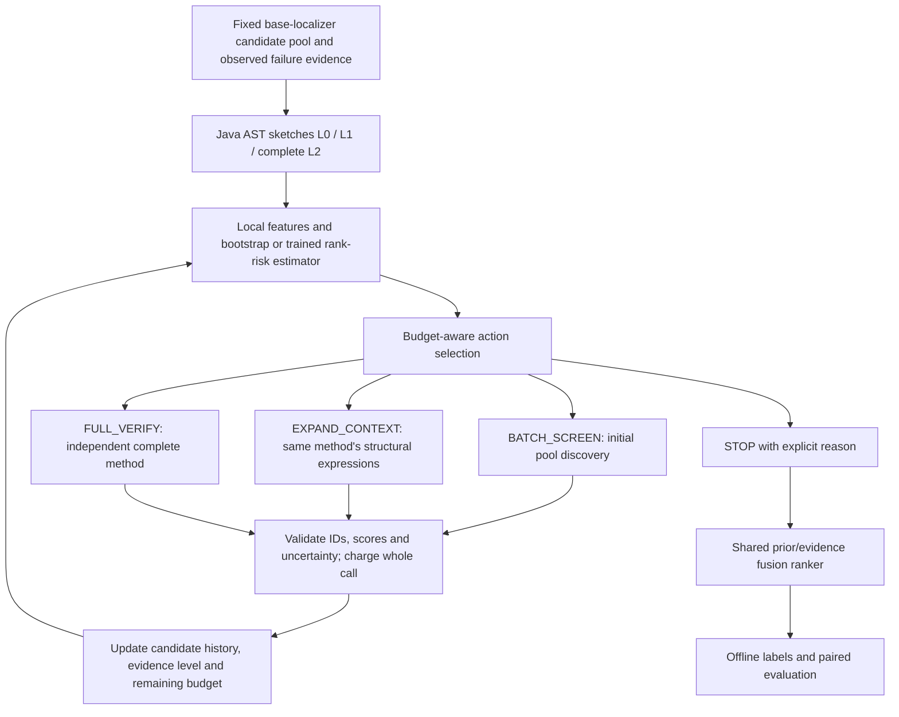

# Adaptive RAVE-FL pilot

This is the executable successor to the rank-threshold Time-25 experiment.
It answers a small feasibility question: can adaptive verification retain fault
localization quality at a lower **verification-stage** token cost?

The old `rave_fl.compare_expanded` entry point is unchanged for reproduction.
Use `python -m rave_fl.pilot` for the new controller. The default experiment
is deliberately limited to at most five bugs. No remote server, model download,
Git push, or benchmark-wide job is launched by this command.

## Implemented flow



- L0 contains the real method signature. L1 extracts Java AST control conditions,
  assignment dependencies, calls, literals, returns and throws. L2 is the exact
  source snippet supplied to the original full verifier. No LLM creates sketches.
- The complete input pool receives initial screening before adaptive escalation.
  This avoids the original gate permanently excluding a low-ranked method.
  If the budget cannot cover initial discovery, the trace records incomplete coverage.
- L0 -> L1 -> L2 is monotonic. A method is never inspected twice at the same level.
  Invalid cheap feedback goes directly to full verification. Invalid full feedback
  remains explicitly unresolved; no fake evidence is invented.
- After every call the controller reevaluates risk, uncertainty, suspicion,
  failure relevance, ranker disagreement, estimated action cost and remaining tokens.
  The next action maximizes a transparent value-per-estimated-token heuristic.
  Confidence and budget affect the decision dynamically; no learned-bandit claim
  is made. A confident cheap negative stays in the final candidate pool.
- `EXPAND_CONTEXT` adds the candidate's structural evidence. This pilot does not
  retrieve arbitrary callees or additional runtime evidence based on free-text
  model requests; `missing_evidence` triggers escalation, and full code is the cap.
- Early stopping requires all candidates screened, a full-confirmed leader,
  a sufficient ranking gap, calibrated candidate risk and no uncertain/invalid/
  high-risk pending item. It is disabled for the untrained bootstrap model.
  Budget exhaustion, inadmissible calls and max steps have separate stop reasons.
  Candidate-risk calibration does **not** certify issue-level stopping safety.

## Ranking and baseline comparability

Every new arm uses `shared_prior_evidence_fusion_v1`:

- uninspected/invalid-feedback method: retain its rank-derived prior score;
- cheap evidence: uncertainty-weighted interpolation with that prior;
- full evidence: use the independently verified suspicion score directly;
- ties: original input order.

Inspection status is never a leading sort key. No method is deleted. The final
ranker is a small deterministic pilot ranker, **not SieveFL's original LLM ranker**.
The current upstream pool is the union of SBIR/Ochiai/BoostN, with actual per-ranker
ranks retained. These priors are not represented as semantic or coverage scores.
The controller starts after candidate generation and leaves the older
Graphify/LeanCTX/Agent4SR workflows alone.

Arms share candidates, model, failure context, seed, output cap per candidate,
complete-code verifier prompt, and final ranker:

| Arm | Behavior |
|---|---|
| `full` | Independently verify every method with L2 |
| `rank_threshold` | Original >=0.60 selection gate, **new shared ranker** |
| `fixed_batch` | Screen every method at L1, fixed batches, no escalation |
| `fixed_sketch` | Screen every method independently at L1 |
| `confidence` | L0 discovery, escalation based on uncertainty and suspicion |
| `adaptive` | L0 discovery, feedback/risk/cost/budget-based escalation |

`rank_threshold` isolates the old gate under the same ranker; it is not an exact
reproduction of the old verified-first ranker. Use `compare_expanded` for that.
The two L0/L1 training probes are separately charged experiments, excluded from
inference-efficiency summaries.

## Install and preflight

From the repository root, using Python 3.10+:

```bash
python -m pip install -r requirements-rave-pilot.txt
python -m pytest tests/test_rave_fl*.py -q
```

LightGBM on macOS may need `brew install libomp`. A Linux/Conda server may instead
already provide its OpenMP runtime. No training occurs during model inference.

Time-25 on the AIScalar checkout described in the earlier documentation:

```bash
bash scripts/aiscalar_rave_fl_time25_data.sh
# If the existing buggy checkout is absent, follow docs/rave_fl_aiscalar.md.
python -m rave_fl.pilot \
  --manifest configs/rave_pilot_time25.json \
  --dry-run --token-budget 60000 \
  --output results/rave_fl_pilot/preflight_new
```

The manifest paths are relative to the working directory. A supplied evidence
file is authoritative; missing/empty files fail instead of changing context.
The source loader validates method names and CSV ranges. These checks do not
replace recording the actual buggy source revision. The manifest can add other
bugs with their **own** checkout, evidence and existing localizer CSVs.
Do not copy Time-25 evidence to a different bug.

## Real small experiment

Ollama must already be running and the exact model tag installed. This command
uses the same model as the supplied report if available on the server:

```bash
python -m rave_fl.pilot \
  --manifest configs/rave_pilot_time25.json \
  --model qwen2.5:7b --base-url http://127.0.0.1:11436 \
  --arms full,rank_threshold,fixed_batch,confidence,adaptive \
  --token-budget 60000 --max-output-tokens 160 --batch-size 4 \
  --context-window 16384 --seed 0 \
  --output results/rave_fl_pilot/time25_qwen_seed0
```

For a cheaper first comparison use `--arms full,adaptive`.
The output directory must be new/empty, so prior measurements cannot be mixed or
overwritten. Repeat with separate seeds/output directories before interpreting
small differences. A different local model is an additional experiment, not a
reproduction of Qwen2.5 on A100.

For a budget curve, repeat the same manifest/arms with budgets such as 8000,
12000 and 16000. Ensure each paired full reference is complete before treating
it as the full baseline. Budget admission includes the complete prompt plus
output allowance. It is conservative but approximate: actual Ollama tokens can
exceed it. An overrun is charged, reported and stops further calls.

## Artifacts and accounting

`run.json` stores provenance, candidate and evidence hashes, model digest,
source features, all observations, per-action decisions and the paired summary.
`report.md` is the short results table. `<bug>/<arm>.json` contains each arm;
`<bug>/<arm>_calls.jsonl` durably records requests and raw responses as they occur.
A failure leaves `failure.json`, completed arm artifacts, and the call ledger.
A transport failure with unknown provider usage aborts the comparison rather
than silently reporting a completed cheap run.

Actual input/output usage comes only from Ollama `prompt_eval_count` and
`eval_count`. Invalid JSON, repeated failure context and escalation calls are
charged exactly once per call. Feature/sketch/model inference uses no LLM tokens.
This experiment has no upstream retrieval LLM calls, so it measures screening
and verification costs. It does not claim end-to-end SieveFL cost or monetary
API billing savings. Provider caching economics are not inferred from tokens.

Offline metrics include Top-1/3/5, full-pool MRR, candidate-pool recall,
screened-gold recall, full-verified-gold recall and positive-evidence-gold recall.
Pool recall alone cannot show that the fault received useful evidence; no
candidate is deleted. Paired bootstrap intervals resample independent bugs;
with one bug no interval is reported. A small pilot cannot prove noninferiority.

## Collect real risk labels

Training needs the outcomes of controlled cheap and complete-code inspections,
not just the reported aggregate token table. Ground truth is first read after
all inference arms finish. No gold identity, patch or complete-code answer enters
the cheap verifier, features or online decision state.

```bash
python -m rave_fl.pilot \
  --manifest configs/rave_pilot_time25.json \
  --model qwen2.5:7b --base-url http://127.0.0.1:11436 \
  --arms full --collect-risk --token-budget 60000 \
  --max-output-tokens 160 \
  --output results/rave_fl_pilot/risk_collection_time25
```

This performs Full, L0 batches and L1 batches as independent arms. The output
`risk_dataset.jsonl` has only allowlisted inference-time features plus offline
labels. Label 1 means the method is gold, full verification marks it suspicious
(>=0.5), and the cheap response rejects it (<0.5 or invalid). This is a
**candidate false-negative harm** target relative to full, not a learned
ranking-flip target. `full_disagreement` is a separate diagnostic, not an oracle
feature. If Full also misses the bug, that row does not become a harmful-cheap
positive merely because the model answers differ.

One bug is usually insufficient. Collect several bugs with both harmful and safe
examples in each split. Repeated responses for one bug must stay in the same split.
Keep all evidence variants of a bug together. Use unseen repositories for a
stronger generalization test; a within-project bug split makes no cross-project
claim. Synthetic fixtures can test plumbing but cannot establish research quality.

## Train, calibrate, evaluate on separate bugs

Create a split file listing actual collected bug IDs:

```json
{
  "train": ["Time-1", "Time-2"],
  "calibration": ["Time-3"],
  "test": ["Time-25"]
}
```

These IDs are an illustration, not an asserted available dataset. Combine real
collected JSONL rows into a dataset and then run:

```bash
python -m rave_fl.train_risk \
  --data results/rave_fl_pilot/risk_dataset.jsonl \
  --split configs/risk_split.json \
  --min-admitted 10 --max-cheap-harm 0.05 \
  --output results/rave_fl_pilot/risk_model.json

python -m rave_fl.pilot \
  --manifest configs/rave_pilot_time25.json \
  --model qwen2.5:7b --base-url http://127.0.0.1:11436 \
  --risk-model results/rave_fl_pilot/risk_model.json \
  --arms full,fixed_batch,confidence,adaptive \
  --token-budget 60000 --max-output-tokens 160 \
  --output results/rave_fl_pilot/time25_learned_heldout
```

LightGBM fits training bugs; isotonic calibration and risk-threshold selection
use only calibration bugs; AUROC, average precision, Brier score and ECE are
reported on test bugs. A separate uncalibrated test score is also recorded.
Missing classes, overlapping bug groups, unknown features and evaluation on
training/calibration bugs are rejected. The model artifact is JSON with native
LightGBM text and calibration knots, not executable pickle.

The empirical calibration harm threshold is not a statistical guarantee. The
current policy is a rule-based decision loop using a learned risk score when
available. A contextual bandit and multi-step RL are **future work**, requiring
sufficient action-outcome data and an honest off-policy evaluation design.

## Decision after the pilot

Compare paired token savings and Top-1/5/MRR against a complete full reference.
Examine which candidates were escalated and why, especially low-ranked gold
methods. A useful early signal is preserved accuracy with lower tokens across
several independent bugs and repeated runs, including improvement over fixed
batching and confidence-only policies at comparable budgets. If fixed batching
matches the adaptive policy, the pilot has not demonstrated the value of risk
prediction. If adaptive escalation costs more than Full, inspect the extra
sketch rounds before expanding the project. Neither outcome from one bug is a
final go/no-go decision about the research hypothesis.

Implementation references: [LightGBM classifier](https://lightgbm.readthedocs.io/en/stable/pythonapi/lightgbm.LGBMClassifier.html),
[isotonic calibration](https://scikit-learn.org/stable/modules/generated/sklearn.isotonic.IsotonicRegression.html),
[Tree-sitter Python API](https://tree-sitter.github.io/py-tree-sitter/).

A completed five-arm run can also export risk observations without new model
calls. The exporter reuses all initial L0 discovery observations from Confidence
and all L1 fixed-batch observations, together with the independent Full baseline.
It rejects incomplete coverage and preserves the original inference snapshots:

```bash
python -m rave_fl.export_risk \
  --run results/rave_fl_pilot/time25_qwen_seed0/run.json \
  --manifest configs/rave_pilot_time25.json \
  --output results/rave_fl_pilot/time25_risk_reused.jsonl
```

To compare a complete Full reference with tighter policy budgets, supply both
budgets explicitly. This preserves a complete reference when the policies cannot
afford to inspect every method:

```bash
python -m rave_fl.pilot \
  --manifest configs/rave_pilot_time25.json \
  --model qwen2.5:7b --base-url http://127.0.0.1:11436 \
  --arms full,confidence,adaptive \
  --token-budget 60000 --policy-budget 16000 --max-output-tokens 160 \
  --output results/rave_fl_pilot/time25_budget16k
```

Audit a finished experiment independently against the raw provider logs:

```bash
python -m rave_fl.audit_pilot \
  --run results/rave_fl_pilot/time25_qwen_seed0/run.json \
  --manifest configs/rave_pilot_time25.json \
  --output results/rave_fl_pilot/time25_qwen_seed0/audit.json
```

Use `python -m pytest tests/test_rave_fl*.py -q` for the RAVE-FL tests.
Unrestricted repository-wide discovery can enter downloaded benchmark projects
under `data/repos`; those projects have their own incompatible test environments.

The adaptive controller also compares expansion cost with a risk-weighted
`L1 cost + risk score * Full cost` proxy. It skips L1 when going directly to
Full is cheaper under that proxy and fits the remaining budget. With bootstrap
risk this expression is a heuristic, not a calibrated expected cost. The reason
`skip_uneconomic_expansion` is visible in the decision trace.

Risk datasets additionally include `ranking_harm_label`: hold every other candidate's
cheap evidence fixed, replace just this candidate with its measured Full
observation, and label whether staying cheap loses full-pool reciprocal rank
relative to that full-verification action. This counterfactual is computed only offline with gold and Full results;
neither enters the feature vector. Train this target with `--target ranking`.
It measures individual harm conditional on the cheap results of other candidates,
not the joint effect of all cheap decisions or a guarantee of issue-level safety.
The default `--target candidate` keeps the original false-negative harm target.
Do not mix the targets when interpreting calibration scores.
