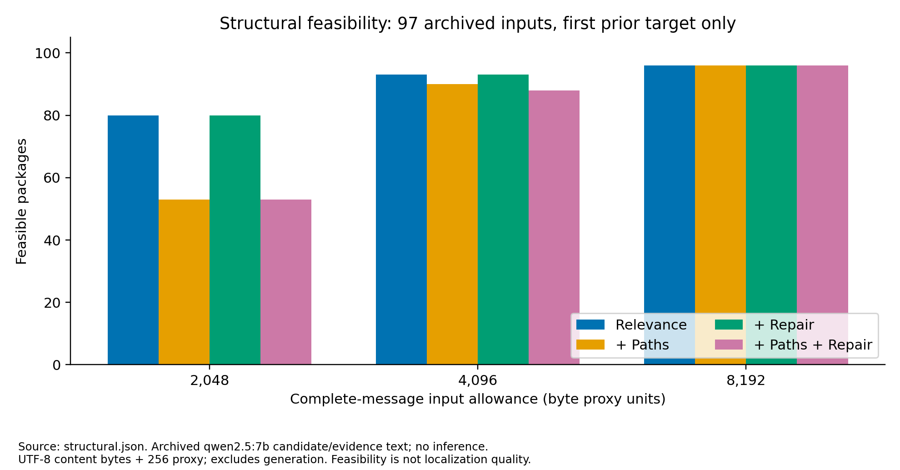
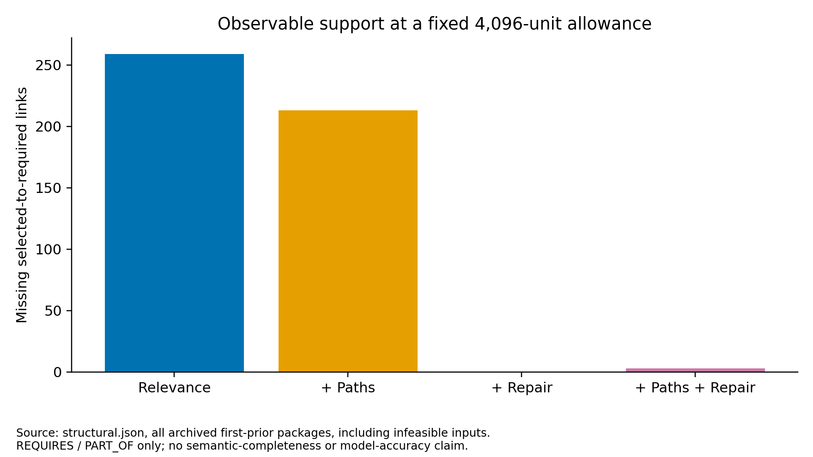
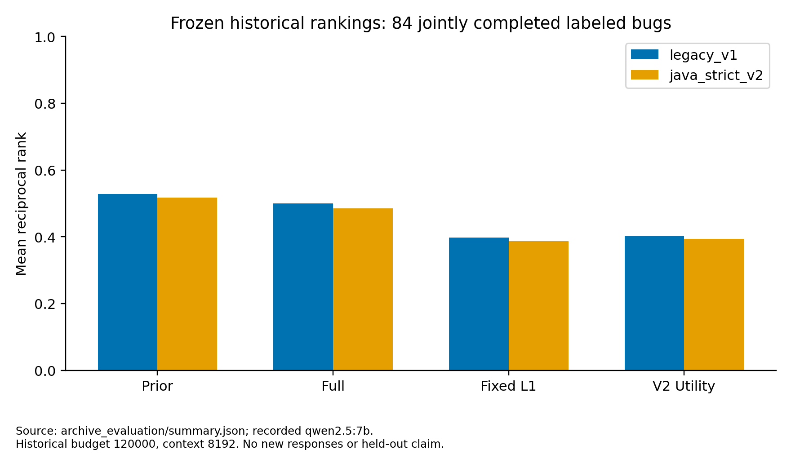
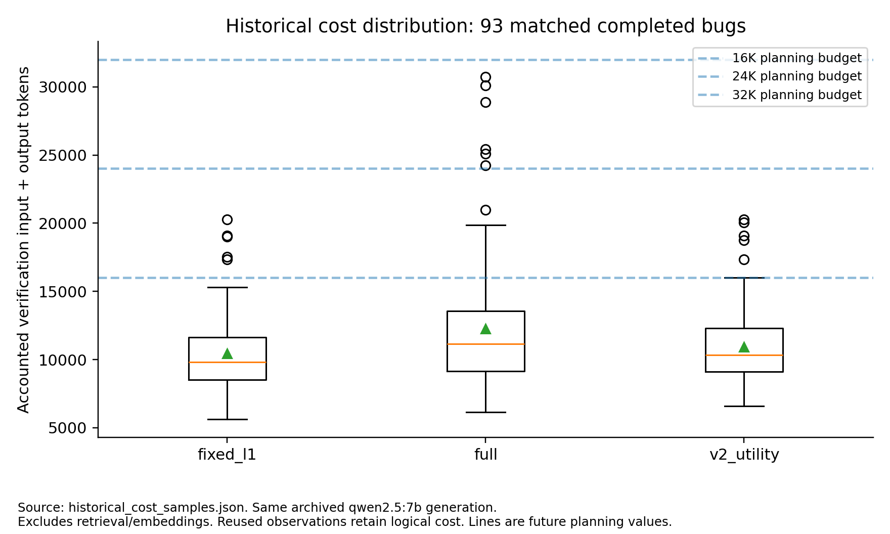
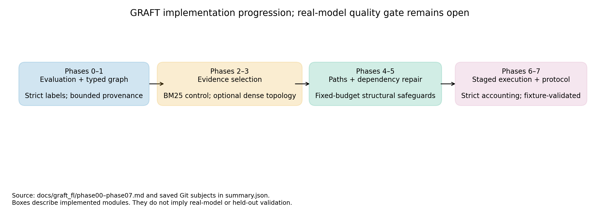

# GRAFT-FL Development Progress

## Scope and outcome

The eight implementation phases are available as opt-in modules. Historical RAVE-FL behavior and raw archives remain intact. This run performed no real model inference, benchmark builds or benchmark tests. The user will run small open-weight-model experiments later, including on an A100. Synthetic fixtures validate orchestration, not research accuracy. No new method has demonstrated superiority to Highest L1 Suspicion or the prior ranking.

## Architecture and completed phases

0. A versioned strict Java evaluator separates exact empty signatures, constructors and case from the historical permissive matcher. Both profiles remain reportable.
1. Typed evidence graphs retain source hashes, spans and extraction provenance. Static calls are MAY_CALL, lexical prerequisites are not reaching-definition proofs, and absent coverage is explicit.
2. BM25 relevance is the default evidence control. Complete system/user messages, wrappers and selected links are charged. Coherent statements are admitted whole.
3. A TopoCompress-inspired dense/sparse selector supports alignment, relevance-gated acceleration, semantic/sequential graph propagation and redundancy penalties. Typed edges and propagation ablations are explicit. A local-only BGE-M3 export adapter is supplied; real weights and real-encoder execution were unavailable in this run. Synthetic vectors exist only in tests.
4. Bounded typed paths augment evidence, then prune under the same input allowance. Unreachable or infeasible protected paths remain reported. Reachability is not causality.
5. Dependency closure restores observable prerequisites and evicts dependent bundles without increasing the allowance. This rule-based repair is not a trained dangling-reference detector and does not guarantee semantic completeness.
6. Sketch, graph and method_full are distinct observations. A bounded untrained router records current features, predicted cost, reservations, selections, rejections and paid outcomes. Legacy controllers are reused, with a small unchanged-identity extension hook in the universal backend.
7. A serial CLI, immutable manifests, exact-response journaling, resource preflight, resume checks, fixture creation and report regeneration support the subsequent experiment. No model/repository downloads occur implicitly.

## Measured offline diagnostics

Source: `/Users/mohammadmahdi/Documents/Heydar LAB/toke optimization/results-100-bugs/results/d4j_multibug/d4j97_promptfix_20261027_122406`. There are 97 prepared inputs, 13794 extracted nodes and 0 candidate AST parse errors. These graphs are bounded by the supplied candidate pool, not repository-wide runtime graphs. Source/frame ambiguity can still limit links.

At 4,096 byte-proxy units, relevance alone produced 93 feasible packages and 259 missing observable support links in 62 first-prior packages. Repair produced 93 feasible packages with 0 missing links. Path preservation retained 90 feasible packages; protected evidence can exceed the allowance. Every diagnostic targets only the first prior candidate, so these rates must not be generalized to all candidate/action states. Missing links are structural counts, not model error labels.




## Historical quality and strongest controls

Both evaluation profiles and frozen historical/RRF re-rankings are in [the metric table](tables/frozen_ranking_metrics.md). The prior remains a mandatory control because historical verification did not establish a consistent gain over it. Strict signature matching changes some apparent successes. RRF here is post-hoc reranking of saved observations, not fresh inference and not proof that an RRF-driven controller would choose the same actions. The older single-bug Llama3.1 generation and the initial Qwen/A100 Time-25 generation are not controller ablations of this archived Qwen2.5 multi-bug generation.



## Resource choice for the user's later experiment

[Cost distributions](tables/historical_costs.md) are calculated from matched completed archive arms, including unlabeled completed bugs for resource planning. The original policy budget was [120000]; it was not the 8,192-token model context. The proposed primary policy budget is 24K verification input+output tokens, with 16K and 32K sensitivity controls. These values are development planning choices informed by observed costs, not experimentally optimized settings. Start with context 8,192 and output cap 160 per candidate, matching the archived generation where the model supports it; use a separately named 16,384-context condition when complete inputs cannot fit. Strict context-window reservations may reject requests even if their expected cost is small.

Keep model tag, immutable digest, endpoint, context, generation options, logical policy budget, per-bug physical cap and whole-run cap separately configurable. Model parameter count does not determine a universal context or budget. An A100's ability to serve a particular large/quantized model must be checked on its actual server; no hardware feasibility or latency claim is made here. Embedding compute is outside generation-token accounting and must be logged separately.



## Selection decision and next gate

Use BM25 plus observable repair as an explicit candidate condition; keep path preservation and topology opt-in. Compare fixed graph actions before the adaptive router so evidence-selection changes can be isolated. Run Prior, Fixed L1, Highest L1 Suspicion, unchanged V2 Utility, L1-plus-graph and the experimental router under the same pool, failure evidence, generation settings, frozen fusion, logical budget and Full-call cap. Full-all is a budget-constrained control at equal budget; a separate 120K reference arm must not be presented as an equal-budget comparison. Add max-Full 0/1/2 and max-graph 0/1/2 ablations as resources permit.

New graph prompts require new model judgments. Historical Full responses cannot be replayed as responses to these changed contexts. Dense selection requires genuine exact-text embeddings. No utility model should be trained until multiple independent defects with reliable labels and complete action histories exist. Do not tune on these archived development bugs and call them held out.

## Implementation Change Log and Experimental Impact

| Phase | Files/modules changed | Previous behavior | New behavior | Measured improvement | Regression/limitation |
|---|---|---|---|---|---|
| 0 | graft/evaluation.py, archive.py | One historical matcher | Versioned strict matching and frozen comparisons | Reproduced legacy metrics; exposed signature sensitivity | Gold labels remain externally supplied |
| 1 | graft/graph.py | Candidate sketches only | Bounded typed graph with source provenance | Recorded graph coverage and parse status | No repository-wide runtime data flow |
| 2 | graft/selection.py | No graph evidence packing | BM25 and complete-message admission | Recorded feasible-package counts | Byte counter is a proxy; selected prerequisites can be absent |
| 3 | graft/topology.py, encode.py | Lexical selection only | Explicit dense/sparse propagation and ablations | Synthetic algorithm tests only | Real encoder/quality not measured |
| 4 | graft/paths.py, selection.py renderer | Independent fragment selection | Path augmentation and link serialization | Recorded reachable/infeasible path outcomes | Protected paths can reduce feasible coverage |
| 5 | graft/repair.py, graph.py | Observable support can dangle | Transitive closure and cascading eviction | Missing observable links reduced at unchanged allowance | Useful optional context may be evicted; semantic gaps remain |
| 6 | graft/controller.py, eval/backend.py identity hook | Legacy sketch/Full stages | Separate graph stage and shared strict accounting | Fixture-tested reuse, caps and paid failures | Untrained utility has no demonstrated ranking advantage |
| 7 | graft/runner.py, cli.py, reporting.py, diagnostics.py, configs/docs/tests | Separate experimental entry points | Immutable staged-run CLI and regenerable reports | Synthetic execution and offline archive diagnostics | Real-model and held-out gates still open |

Phase 7 also hardened immutable graph lookup, nonnegative path costs, encoder batch-length validation, required graph uncertainty, all-arm resume checks and failed-preparation denominators. These are correctness changes, not measured localization gains. Phase commits and focused validation records are in the phase documents; the final phase commit is identifiable by its Git subject. Existing universal tests are reported as existing, not newly added.

## Limitations and unresolved work

Real BGE-M3 execution, real graph-verdict parsing across model families, independent-defect localization quality, runtime coverage extraction and repository-wide call/data-flow grounding remain unvalidated or external. Java/Python method parsing is supported; the GRAFT wrapper rejects unsupported languages/granularities rather than claiming universal structural support. Test fixtures are synthetic and must never be calibration data. Existing nine empty labels and candidate-recall gaps need independent curation. Path/source coherence does not imply causal fault evidence. More evidence can displace useful details, and graph versus method_full is not an information hierarchy.

## Reproducibility and change log

Generated input checksums are retained in `provenance.json`; all directly consumed archive inputs were unchanged at completion. `summary.json` records model settings, cost distributions, graph counts, feasibility and Git subjects. The module changes, tests and decisions are documented separately in `docs/graft_fl/phase00.md` through `phase07.md`. Exact commands, future-run manifests and protocol are in `docs/GRAFT_FL.md` and `configs/graft_*`.



Regenerate into a new output directory:

```bash
python3 -m rave_fl.graft.cli diagnostics --archive results-100-bugs/results/d4j_multibug/d4j97_promptfix_20261027_122406 --output /tmp/graft-diagnostics-new
```

This entry point reads saved inputs and rankings, computes structural diagnostics, preserves consumed-source hashes, and generates all tables and PNG/SVG figures without contacting a model. It does not reproduce historical inference. Per-run real/synthetic reports use `python3 -m rave_fl.graft.cli report --run-dir RUN_DIR`.
