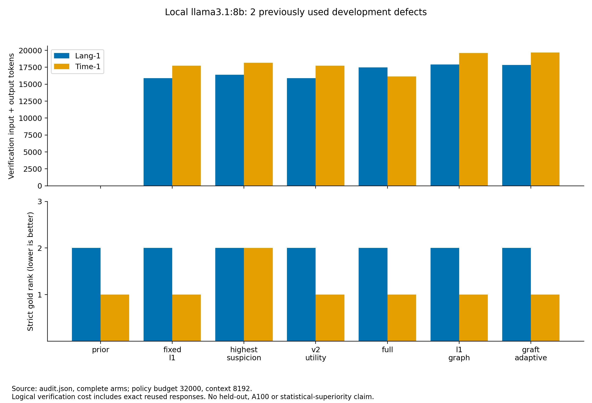

# GRAFT-FL local real-model test report

## Outcome

The revised pipeline completed all 14 comparison arms on the two available development defects with zero invalid final observations, no logical-budget violations, no unknown provider usage and no new requests on resume. The selected regression suite passed 189 tests. This clears a local software/model compatibility gate; it does not establish A100 performance or a localization-quality improvement.

## Experimental conditions

- Local macOS, Ollama, Llama3.1 8B Q4_K_M; immutable digest `46e0c10c039e019119339687c3c1757cc81b9da49709a3b3924863ba87ca666e`. The actual provider metadata is in the audits/raw manifests.
- Existing Time-1 and Lang-1 development checkouts, 24 candidates each, supplied trigger-test descriptions. No official failing tests were run and no new observed-failure evidence was generated.
- Math-1 failed source-span validation before inference: `Fraction.negate()` was absent at the supplied CSV lines 406–415. It remains an unsuccessful selected case in the initial run, not a replaced or model-failed defect.
- Lang-54, Math-80 and Closure-61 remain the separate preselected subsequent feasibility list. They were not executed in this local test.
- Initial condition: graph verdict v1, L1 batch size two, 24K logical policy budgets. Revised condition: graph verdict v2 short strings, L1 batch size one, equal 32K logical budgets. Model, seed, temperature, context 8192, output cap 160 per candidate, RRF, pool and failure text remained fixed.
- The revision changes multiple compatibility settings, including the amount of evidence fitting the complete-message allowance after system-text changes. Differences between rounds are not isolated prompt/controller accuracy effects.

## Completed revised-condition results

| Policy | Lang-1 strict rank | Time-1 strict rank | Mean verification tokens | MRR on two development bugs |
|---|---:|---:|---:|---:|
| prior | 2 | 1 | 0.0 | 0.75 |
| fixed_l1 | 2 | 1 | 16,815.5 | 0.75 |
| highest_suspicion | 2 | 2 | 17,284.0 | 0.50 |
| v2_utility | 2 | 1 | 16,815.5 | 0.75 |
| full | 2 | 1 | 16,805.0 | 0.75 |
| l1_graph | 2 | 1 | 18,765.5 | 0.75 |
| graft_adaptive | 2 | 1 | 18,758.0 | 0.75 |



The adaptive graph policy used 11.55% more verification tokens than Fixed L1 on average, with the same final ranks. V2 selected no Full upgrades and matched Fixed L1. Full also matched the prior ranks. No graph upgrade or adaptive Full action improved marginal MRR in these recorded states. Highest Suspicion harmed Time-1 (rank 1 to 2; marginal MRR −0.5) after inspecting `UnsupportedDurationField.compareTo(DurationField)`. This is a state-specific observed harm, not a general claim about that baseline.

The prior already ranks Time-1 first, so this case has no room for an MRR gain over the prior. Lang-1 remains second under every completed policy. These two previously used, strong-prior cases are too limited to establish either usefulness or futility of graph context on independent defects. No confidence interval or noninferiority claim is made.

## What the real test exposed and what changed

1. Initial batched L1 responses sometimes omitted a candidate ID. Atomic validation correctly marked the entire affected batch invalid and retained paid cost. Single-candidate requests avoided that failure in the observed follow-up; output/model-family robustness is not universally proven.
2. Initial graph responses produced long explanation arrays and exhausted their output cap, leaving malformed JSON. Verdict v2 requests short string fields, versions the new prompt, and rejects non-string explanation fields after charging the request. All revised graph calls parsed successfully.
3. Full stopped under the initial 24K budget due to conservative full-context reservations, despite no actual budget overrun. Equal 32K policy budgets allowed completed Full controls in the follow-up. This is admission headroom, not improved fault evidence.
4. The untrained router selected helpers at current ranks 8/23 in Lang-1 and 12/23 in Time-1. Cheap-cost priorities and missing-evidence/uncertainty gates permitted these actions, but every selected adaptive upgrade had zero marginal MRR. This suggests an allocation hypothesis to test independently, not an outcome-trained policy fix.
5. In the invalid initial Lang-1 fixed-graph arm, the partial gold rank reached 22. An invalid latest graph observation can replace a valid L1 ranking observation in the current router; RRF then drops that evidence term. The arm is explicitly incomplete. Retaining the last valid ranking observation while separately tracking failed attempts is a known future robustness option; it was not silently implemented or scored as a completed result.

## Physical versus logical accounting

The initial run paid 62,893 provider input+output tokens over 76 requests. The follow-up added 42,201 tokens over 59 new requests. Combined physical usage was 105,094 tokens over 135 requests, within the separately recorded 80K and 60K round caps. No cap was silently increased during a run.

The follow-up also reused 45 exact Full observations, whose recorded counters total 31,893 tokens. Thus its incremental 42,201 physical tokens must not be mistaken for a fresh-from-empty-cache bill. Distinct observations supporting the complete condition account for 74,094 recorded tokens including those reused observations. Logical per-policy costs in the table include every selected observation, including reuse. Embedding, retrieval, builds and whole-pipeline costs are outside this token definition. No real BGE-M3 encoding occurred.

All final rankings were reconstructed from recorded calls using the frozen fusion; every reconstruction matched. Paid logical call sums and physical journal counters matched saved accounting. Resuming the completed revised run added zero requests/tokens. Raw prompts/responses, manifests, journals, candidate sources, evaluation-only labels and caches are packaged in `raw_runs.tar.gz` with a SHA-256 in `verification.json`. The shared cache is append-only across conditions; initial paid request/response ledgers remain preserved.

## Readiness and next step

The BM25-plus-repair path is ready for a bounded A100 feasibility test after installing the required data/model and passing server preflight. The checked-in A100 config now starts with batch size one and a 32K logical budget. Keep paths and dense topology as explicit optional conditions; their real-model quality and real BGE encoding remain open gates. A100 execution and the three new bugs are not validated by this local run.

Run the three preselected new defects first, then a preregistered exploratory 10–15-defect set if execution and evidence validity hold. Compare Prior, Fixed L1, Highest Suspicion and V2 before proposing any advanced-policy benefit. Do not start a large multi-model sweep or train LightGBM from these two defects. Investigate a hard top-k/no-upgrade control and last-valid-observation fallback as explicit future ablations, without choosing them from gold outcomes.

## Artifacts and reproduction

- `initial/REPORT.md`, `initial/audit.json`: all initial unsuccessful/completed attempts, partial ranks and accounting.
- `followup/REPORT.md`, `followup/audit.json`, `followup/ranking_evolution.json`: complete revised comparison and all marginal transitions.
- `validation/`: both software-test logs, initial preflight/source failure, input manifest and completed-run resume counters.
- `protocol.json`: frozen compatibility conditions and cost limits; `verification.json`: combined counters/checksums.
- `raw_runs.tar.gz`: complete new local raw runs and input manifest. Existing historical results were not overwritten.
- Code revisions: initial engine `4c7ebcb`; short-verdict/admission revision `699cac5`. Exact per-file implementation identities remain in each raw manifest.

```bash
python3 scripts/audit_graft_local_smoke.py --run-dir results/graft_fl/local_real_smoke_followup_20261105 --output /tmp/graft-smoke-audit-new
python3 -m pytest -q tests/test_graft_*.py tests/test_rave_eval.py tests/test_rave_fl*.py
```

Archive extraction supports offline auditing without a model or checkout. Use a new output directory. To run new inference, follow `docs/GRAFT_FL.md` and `configs/graft_smoke_a100.json`; local smoke configs retain host-specific paths and are provenance records, not portable server manifests.
